# PatiVet — Veteriner Kliniği Randevu ve Hasta Takip Sistemi

| | |
|---|---|
| **Öğrenci Numarası** | b241210351 |
| **Adı Soyadı** | Damla Söylemez |
| **Ders Grubu** | 1B |
| **Ders** | Web Programlama — Sakarya Üniversitesi |
| **GitHub** | https://github.com/damlas123/VeterinerKlinigi |

## Proje hakkında

PatiVet; hayvan sahiplerinin (üyeler) evcil hayvanlarını kaydedip **veteriner, hizmet, tarih ve saat** seçerek randevu aldığı,
veterinerlerin randevuları onaylayıp **muayene notu ve aşı kaydı** girdiği, yöneticinin ise **klinik, hizmet, veteriner, kullanıcı
ve ciro raporlarını** yönettiği bir ASP.NET Core MVC uygulamasıdır.

Aynı iş kuralları üç farklı kanaldan kullanılır ve **tek bir yerde (Business katmanı)** yazılmıştır:

```text
  MVC sayfaları (Web)   ─┐
  REST API (/api/...)   ─┼──►  Business katmanı (I*Service → *Manager)  ──►  Data (EF Core)  ──►  SQL Server
  MCP araçları (/mcp)   ─┘     iş kuralları, sahiplik kontrolleri, çakışma kontrolü
```

## Kullanılan teknolojiler

| Alan | Teknoloji |
|---|---|
| Çatı | ASP.NET Core MVC **.NET 10**, C# |
| Veri | Entity Framework Core 10 (Code First, Fluent API, migration), SQL Server / LocalDB, LINQ |
| Kimlik | ASP.NET Core Identity (çerez) + JWT Bearer (API ve MCP) |
| API | REST, DTO, ProblemDetails, OpenAPI dokümanı (`/openapi/v1.json`, geliştirme ortamında) |
| MCP | `ModelContextProtocol.AspNetCore` 2.4.0 (resmî C# SDK), HTTP transport, `/mcp` |
| Arayüz | Bootstrap 5, Bootstrap Icons, jQuery, jQuery Validation (unobtrusive), Chart.js |
| Test | xUnit, EF Core SQLite (in-memory) |
| Mimari | Katmanlı mimari, Dependency Injection, Repository + Unit of Work, Central Package Management |

## Proje yapısı

```text
VeterinerKlinigi.slnx
├── src/VeterinerKlinigi.Entities   → Entity sınıfları, enum'lar, sabitler (RoleNames, FieldLengths)
├── src/VeterinerKlinigi.Data       → AppDbContext, Fluent API ayarları, Migrations, Repository/UnitOfWork, Seed
├── src/VeterinerKlinigi.Business   → Abstract (I*Service), Concrete (*Manager), Dtos, Rules, Security (AccessScopes)
├── src/VeterinerKlinigi.API        → REST controller'ları, JWT üretimi, yetkilendirme politikaları
├── src/VeterinerKlinigi.Web        → Çalışan proje: MVC, Areas (Admin/Veterinarian/Member), MCP araçları, Program.cs
├── tests/VeterinerKlinigi.Tests    → xUnit testleri: randevu kuralları, çakışma, sahiplik (yetki) kontrolleri
└── docs/                           → Gereksinim analizi, mimari, geliştirme planı, ekran görüntüleri
```

Katman bağımlılıkları tek yönlüdür: `Web → API → Business → Data → Entities`. Ayrıntı: [docs/01](docs/01-gereksinim-analizi-ve-mimari.md), [docs/02](docs/02-solution-ve-proje-yapisi.md), [docs/03](docs/03-entity-ve-dbcontext.md).

### Veritabanı (ER özeti)

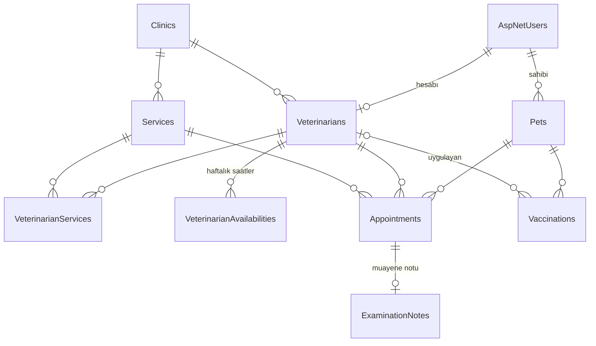

## Kurulum

**Gereksinimler:** Visual Studio 2026 (ASP.NET ve web geliştirme iş yükü) veya .NET 10 SDK, SQL Server LocalDB (Visual Studio ile gelir).

1. Depoyu klonlayın ve `VeterinerKlinigi.slnx` dosyasını açın. Başlangıç projesi: **VeterinerKlinigi.Web**.
2. (Önerilir) Kalıcı bir JWT anahtarı tanımlayın. Anahtar **depoya konmaz**, Windows kullanıcı profilindeki user-secrets'ta saklanır:
   ```powershell
   dotnet user-secrets set "Jwt:Key" "en-az-32-karakterlik-gizli-bir-anahtar-yazin-123" --project src/VeterinerKlinigi.Web
   ```
   Tanımlanmazsa uygulama her açılışta geçici bir anahtar üretir (uyarı loglanır; yeniden başlatınca eski token'lar geçersiz olur).
3. **F5** ile çalıştırın. İlk açılışta uygulama kendiliğinden:
   - bekleyen migration'ları uygular (`VeterinerKlinigiDb` veritabanını oluşturur),
   - rolleri (Admin, Veteriner, Uye) ve admin hesabını ekler,
   - örnek verileri (2 klinik, hizmetler, 4 veteriner, 2 üye, evcil hayvanlar, randevular, aşılar) ekler.
4. Adres: `https://localhost:7080` (veya `http://localhost:5080`).

Farklı bir SQL Server kullanılacaksa bağlantı dizesi de user-secrets ile verilebilir:
`dotnet user-secrets set "ConnectionStrings:DefaultConnection" "Server=...;Database=VeterinerKlinigiDb;Trusted_Connection=True;TrustServerCertificate=True" --project src/VeterinerKlinigi.Web`

Migration'ı elle uygulamak isterseniz: Package Manager Console → Default project **VeterinerKlinigi.Data** → `Update-Database`.

### Ortam değişkenleri ve ayarlar

Ayarlar `src/VeterinerKlinigi.Web/appsettings.json` dosyasındadır. **Gizli değerler depoya konmaz**; user-secrets veya ortam değişkeni
ile verilir (ortam değişkeninde `:` yerine `__` yazılır, ör. `Jwt__Key`).

| Ayar | Varsayılan | Açıklama |
|---|---|---|
| `ConnectionStrings:DefaultConnection` | LocalDB, `VeterinerKlinigiDb` | SQL Server bağlantı dizesi. Parola içeren dize yalnızca user-secrets / ortam değişkeni ile verilmelidir. |
| `Jwt:Key` | *(yok)* | JWT imzalama anahtarı, en az 32 karakter. Geliştirmede tanımlı değilse geçici anahtar üretilir; üretimde **zorunludur**. |
| `Jwt:Issuer`, `Jwt:Audience`, `Jwt:ExpiryMinutes` | `VeterinerKlinigi`, `VeterinerKlinigi.Clients`, `120` | Token ayarları |
| `Seed:AdminEmail`, `Seed:AdminPassword` | `b241210351@sakarya.edu.tr`, `sau` | İlk açılışta oluşturulan admin hesabı (ödev gereği) |
| `Seed:CreateDemoData`, `Seed:DemoPassword` | `true`, `Demo123!` | Örnek klinik, veteriner, üye ve randevu verileri |
| `Appointment:SlotIntervalMinutes`, `Appointment:MaxDaysAhead` | `15`, `60` | Randevu saat aralığı ve en fazla kaç gün ileriye randevu alınabileceği |
| `ASPNETCORE_ENVIRONMENT` | `Development` (launchSettings) | `Development` dışında hata ayrıntısı gizlenir, HSTS açılır, OpenAPI dokümanı kapanır. |

### Komut satırından çalıştırma

```powershell
dotnet restore
dotnet run --project src/VeterinerKlinigi.Web --launch-profile http   # http://localhost:5080
```

Veritabanı ilk çalıştırmada otomatik oluşturulur. Elle migration uygulamak için (`dotnet tool install --global dotnet-ef` gerekir):
`dotnet ef database update --project src/VeterinerKlinigi.Data --startup-project src/VeterinerKlinigi.Web`

## Demo hesapları

| Rol | E-posta | Parola |
|---|---|---|
| Admin | `b241210351@sakarya.edu.tr` | `sau` |
| Veteriner | `ayse.yilmaz@pativet.test` · `mehmet.demir@pativet.test` · `zeynep.kaya@pativet.test` · `can.ozturk@pativet.test` | `Demo123!` |
| Üye | `uye@pativet.test` (Pamuk, Karabaş) · `uye2@pativet.test` (Maviş, Tarçın) | `Demo123!` |

> Admin parolası ödev gereği `sau`'dur; kayıt formundaki parola kuralları (en az 8 karakter, büyük/küçük harf, rakam) yalnızca yeni kayıtlar için geçerlidir.

## Roller ve ekranlar

| Rol | Yapabildikleri |
|---|---|
| **Ziyaretçi** | Ana sayfa, hizmetler, veteriner listesi/detayı, hakkında, iletişim, kayıt ol, giriş |
| **Üye** | Dashboard (yaklaşan randevu, aşı hatırlatma), evcil hayvan CRUD (fotoğraf yükleme), randevu sihirbazı (uygun saatler canlı gelir), randevu düzenleme/iptal, aşı takvimi, sağlık geçmişi |
| **Veteriner** | Dashboard (bugünkü program, 7 günlük grafik), randevu onay/ret, muayene notu girip randevuyu tamamlama, hastalar, aşı kaydı ekle/düzenle/sil, haftalık müsaitlik saatleri |
| **Admin** | Dashboard (istatistik kartları + grafikler), klinik/hizmet/veteriner CRUD, veteriner müsaitlikleri, kullanıcılar (kilitle/aç), tüm hayvanlar ve randevular (filtreli), ciro raporu |

**Sahiplik kontrolü:** Bir üye başka üyenin hayvanını/randevusunu, bir veteriner başkasının hastasını URL'deki id'yi değiştirerek göremez.
Bütün sorgular `AccessScopes` filtrelerinden geçer; erişimi olmayan kayıt için **404** döner (kaydın varlığı bile sızdırılmaz).

## Randevu kuralları (AppointmentManager)

| Kural | Açıklama |
|---|---|
| Geçmiş tarih | Geçmiş bir zamana randevu alınamaz; en fazla 60 gün ileriye alınabilir. |
| Saat aralığı | Başlangıç saatleri 15 dakikalık aralıklara oturur (09:00, 09:15 ...). |
| Bitiş saati | `Bitiş = Başlangıç + hizmet süresi`; süre ve ücret randevuya kopyalanır (hizmet sonradan değişse de geçmiş bozulmaz). |
| Müsaitlik | Randevu, hekimin o günkü müsaitlik aralığının **ve** kliniğin çalışma saatlerinin tamamen içinde olmalıdır. |
| Hizmet–hekim | Hekim seçilen hizmeti verebiliyor olmalıdır; pasif hekim/hizmet/hayvan için randevu alınamaz. |
| **Çakışma** | Aynı hekimin `Bekliyor`/`Onaylandı` randevularıyla **zaman aralığı** kesişemez: `yeniBaşlangıç < mevcutBitiş && mevcutBaşlangıç < yeniBitiş`. Örn. 10:00–10:30 varken 10:15 reddedilir, 10:30 kabul edilir. |
| Hayvan çakışması | Aynı hayvanın aynı saatte iki randevusu olamaz. |
| Eşzamanlılık | Kontrol + kayıt **Serializable** transaction içinde yapılır; iki kişi aynı anda aynı saate basarsa biri reddedilir. |
| Durum akışı | `Bekliyor → Onaylandı / Reddedildi (gerekçe zorunlu) / İptal`, `Onaylandı → Tamamlandı (muayene notuyla) / İptal`. Saati geçmiş randevu iptal edilemez. |

## REST API

Tüm uçlar JSON döner; hatalar **ProblemDetails** biçimindedir (`400` doğrulama, `401` giriş yok, `403` yetki yok, `404` bulunamadı/erişim yok, `409` çakışma).

| Metot | Uç | Yetki | Açıklama |
|---|---|---|---|
| POST | `/api/auth/token` | Herkes | E-posta + parola → JWT |
| GET | `/api/auth/me` | Giriş | Token sahibinin bilgileri |
| GET | `/api/clinics`, `/api/clinics/{id}` | Herkes | Klinikler |
| GET | `/api/services?clinicId=` , `/api/services/{id}` | Herkes | Hizmetler |
| GET | `/api/veterinarians?clinicId=&serviceId=&specialty=`, `/{id}` | Herkes | Veterinerler (+ müsaitlik) |
| GET | `/api/pets`, `/api/pets/{id}`, `/api/pets/{id}/vaccinations` | Giriş | Rolüne göre görebildiği hayvanlar, aşı takvimi |
| GET | `/api/appointments?status=&from=&to=&veterinarianId=&petId=` | Giriş | Rolüne göre randevular |
| GET | `/api/appointments/{id}` | Giriş | Randevu detayı |
| GET | `/api/appointments/available-slots?serviceId=&date=&veterinarianId=` | Giriş | Uygun saatler |
| POST | `/api/appointments` | JWT (Üye/Admin) | Randevu oluştur → `201 Created` |
| POST | `/api/appointments/{id}/approve` · `/reject` · `/cancel` | JWT | Durum değişiklikleri |
| GET | `/api/reports/revenue?from=&to=&clinicId=` | Admin | **LINQ ile hizmet bazında ciro raporu** |
| GET | `/api/reports/dashboard` | Admin | Dashboard grafik verileri |
| GET | `/api/system/status` | Herkes | Uygulama ve veritabanı durumu |

Okuma uçları tarayıcıdaki oturum çereziyle de çalışır (sayfalardaki grafikler ve randevu sihirbazı bu sayede API'yi kullanır).
**Veri değiştiren uçlar yalnızca JWT kabul eder** — böylece başka bir sitenin, kullanıcının çerezini kullanarak istek atması (CSRF) mümkün olmaz.

**Örnek — token al ve randevu oluştur:**

```http
POST /api/auth/token
Content-Type: application/json

{ "email": "uye@pativet.test", "password": "Demo123!" }
```
```json
{ "accessToken": "eyJhbGciOi...", "tokenType": "Bearer", "expiresAt": "2026-11-25T12:00:00+00:00", "email": "uye@pativet.test", "roles": ["Uye"] }
```
```http
POST /api/appointments
Authorization: Bearer eyJhbGciOi...
Content-Type: application/json

{ "petId": 1, "serviceId": 1, "veterinarianId": 1, "appointmentDate": "2026-11-26T10:00:00", "ownerNote": "İştahsızlık" }
```
Çakışma olursa:
```json
{ "status": 409, "title": "Çakışma", "detail": "Seçilen saat dolu: Vet. Hek. Ayşe Yılmaz hekiminin 10:00-10:30 arasında başka bir randevusu var. 'Genel Muayene' 30 dakika sürdüğü için 10:15-10:45 aralığı bu randevuyla çakışıyor." }
```

Hazır istek örnekleri: [`src/VeterinerKlinigi.Web/VeterinerKlinigi.Web.http`](src/VeterinerKlinigi.Web/VeterinerKlinigi.Web.http) (Visual Studio'da dosyayı açıp "Send request" ile çalıştırılır; Postman ile de aynı istekler atılabilir).

## MCP sunucusu (Model Context Protocol)

Uygulama `/mcp` adresinde bir MCP sunucusu yayınlar. Yapay zekâ asistanları (Claude Desktop, VS Code, MCP Inspector) bu araçları çağırabilir.
Araçlar REST API ile **aynı servisleri** (`IAppointmentService`, `IVaccinationService` ...) kullanır; kural ve sahiplik kontrolleri aynıdır.

| Araç | Açıklama |
|---|---|
| `uygun_saatler` | Hizmet ve tarih için boş hekim/saatleri listeler |
| `asi_takvimi` | Hayvan adı veya id'sine göre aşı geçmişi, yaklaşan ve geciken dozlar |
| `randevu_olustur` | Randevu talebi oluşturur (çakışma kontrolüyle) |
| `hayvanlarim` | Kullanıcının evcil hayvanları |
| `hizmet_listesi` | Hizmetler (id, süre, ücret) |
| `randevularim` | Kullanıcının randevuları (durum filtresiyle) |

**MCP Inspector ile test:**

1. Uygulamayı çalıştırın; giriş yapıp **Profil menüsü → API / MCP** sayfasından token alın (veya `POST /api/auth/token`).
2. Terminal: `npx @modelcontextprotocol/inspector`
3. Inspector'da: Transport **Streamable HTTP**, URL `http://localhost:5080/mcp`,
   Authentication → Header `Authorization`, değer `Bearer <token>` → **Connect**.
4. **Tools → List Tools** ile altı aracı görün; örn. `hizmet_listesi`, ardından `uygun_saatler` (`serviceId=1`, `date=2026-11-26`) ve `randevu_olustur`'u çalıştırın.
   Oluşan randevu, web sitesinde üye panelinde ve veteriner panelinde **Bekliyor** olarak görünür.

Token olmadan `/mcp` çağrılırsa **401** döner. Token'ın sahibi admin tarafından kilitlenirse token süresi dolmadan
REST API ve MCP istekleri de hemen **401** almaya başlar (her istekte hesap durumu kontrol edilir).

> MCP Inspector'ın yeni (2.x) arayüzünde: **Servers → Add Servers** ile `Streamable HTTP` ve `http://localhost:5080/mcp` adresli
> bir sunucu ekleyin, **Settings → Custom Headers** bölümüne `Authorization: Bearer <token>` yazın, ardından sunucunun anahtarını
> açıp **Tools** sekmesine geçin.

**MCP Inspector'dan `asi_takvimi` aracının çağrılması** (üye hesabıyla, `hayvanAdi = Pamuk`):

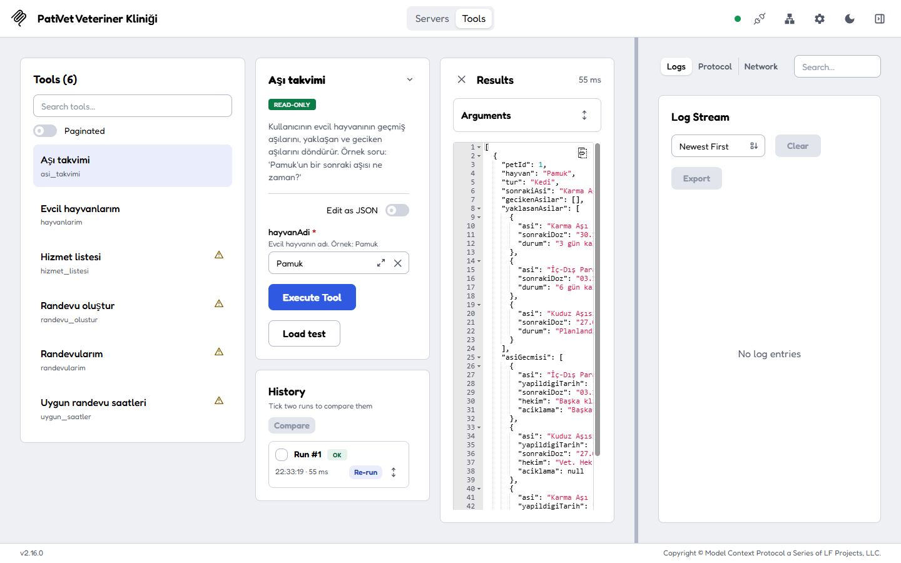

## Güvenlik ve doğrulama

- Parolalar Identity ile hash'lenir; 5 hatalı girişte hesap 5 dakika kilitlenir; admin hesapları kilitleyebilir.
- Tüm formlarda **anti-forgery token** (CSRF) otomatik doğrulanır; çerez `HttpOnly` + `SameSite=Lax`.
- Doğrulama hem istemcide (jQuery Validation, Türkçe ondalık desteği) hem sunucuda (DataAnnotations + iş kuralları) yapılır.
- Fotoğraf yükleme: yalnızca JPG/PNG/WEBP, en fazla 2 MB, dosya imzası (magic bytes) kontrolü, rastgele (GUID) dosya adı.
- JWT her istekte doğrulanırken hesabın hâlâ var olduğu ve kilitli olmadığı kontrol edilir (kilitlenen kullanıcının token'ı hemen geçersiz olur).
- Razor çıktıları otomatik HTML-encode edilir (XSS); jQuery ile eklenen metinlerde `.text()` kullanılır.
- Güvenlik başlıkları: `X-Content-Type-Options`, `X-Frame-Options`, `Referrer-Policy`; üretimde HSTS.
- JWT anahtarı ve özel bağlantı dizeleri depoda tutulmaz (user-secrets).

## Testler

Otomatik testler `tests/VeterinerKlinigi.Tests` projesindedir (xUnit). İş servisleri, uygulamanın kendi `AppDbContext`'i ve
Fluent API ayarlarıyla **SQLite in-memory** veritabanı üzerinde çalıştırılır; SQL Server gerekmez.

```powershell
dotnet test
```

| Test sınıfı | Neyi doğrular? |
|---|---|
| `AppointmentRulesTests` | Zaman aralığı çakışması (10:00-10:30 varken 10:15 çakışır, 10:30 çakışmaz), müsaitlik aralığına sığma, 15 dk hizalama, uygun saat üretimi |
| `AppointmentManagerTests` | Randevunun *Bekliyor* olarak oluşması, süre/ücretin hizmetten kopyalanması, hizmet süresiyle çakışma (409), müsaitlik ve klinik saatleri dışı, geçmiş tarih, başka üyenin hayvanı (404), veterinerin randevu açamaması, onay/ret/iptal yetkileri, reddedilen randevunun saati boşaltması, uygun saat listesi |
| `AccessScopeTests` | Üyenin sadece kendi hayvanlarını ve aşı takvimini görmesi, id değiştirerek başkasının kaydına erişememesi, veterinerin sadece kendi hastalarını görmesi |

### Elle test senaryoları

| # | Senaryo | Beklenen |
|---|---|---|
| 1 | `uye@pativet.test` ile giriş → Yeni randevu → Pamuk, Genel Muayene, yarın | Hekimlerin boş saatleri listelenir |
| 2 | Aynı hekim/saat için ikinci üyeyle (`uye2@`) randevu almayı dene | Saat listede görünmez; API'den denenirse **409** |
| 3 | 10:00–10:30 randevusu varken 10:15'e randevu (API) | **409 Çakışma**; 10:30 başarılı |
| 4 | Üye olarak `/Member/Pets/Details/{başkasının id'si}` | **404** sayfası |
| 5 | Veteriner olarak bekleyen randevuyu onayla → "Muayeneyi tamamla" | Durum **Tamamlandı**, ciro raporuna eklenir |
| 6 | Admin → Raporlar | Hizmet bazında ciro tablosu ve grafik |
| 7 | Token olmadan `POST /api/appointments` | **401** |
| 8 | MCP Inspector → `randevu_olustur` | Randevu oluşur, web panelinde görünür |
| 9 | Kayıt formunda zayıf parola / geçersiz e-posta | Türkçe doğrulama mesajları |
| 10 | Admin → veteriner sil (randevu geçmişi olan) | Silinmez, pasif yapılır |

## Ekran görüntüleri

| | |
|---|---|
| **Ana sayfa** 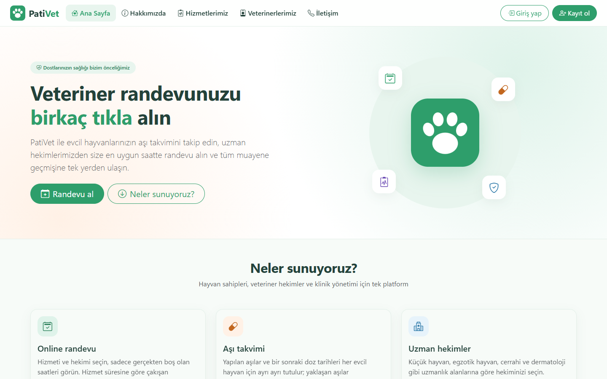 | **Giriş** 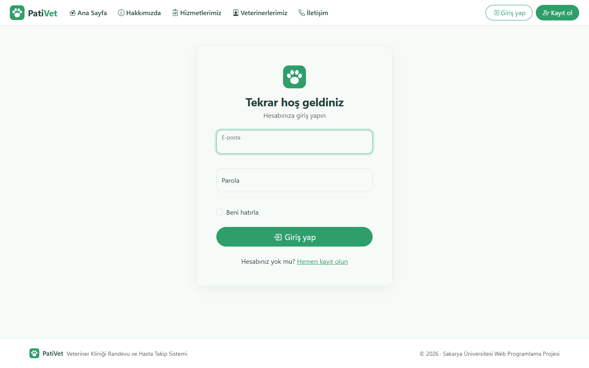 |
| **Üye paneli** 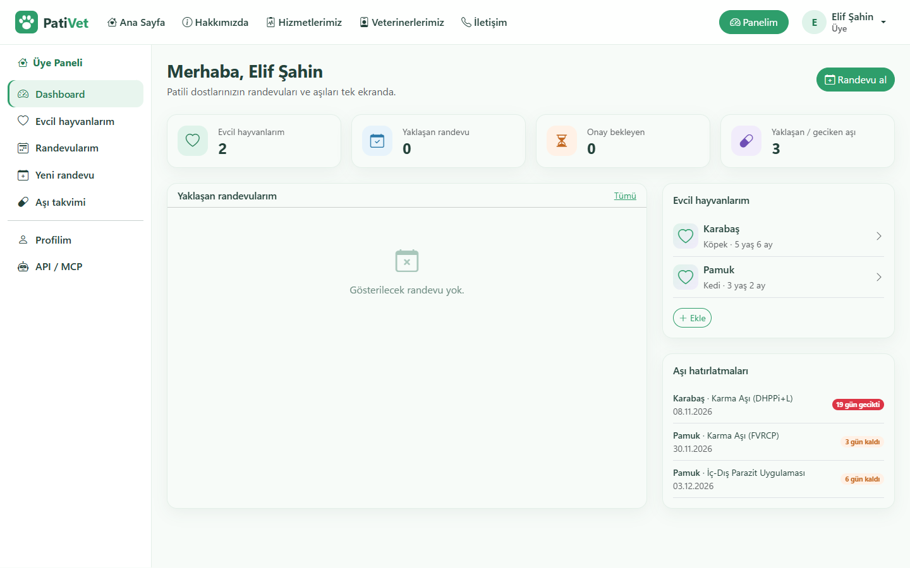 | **Evcil hayvanlarım** 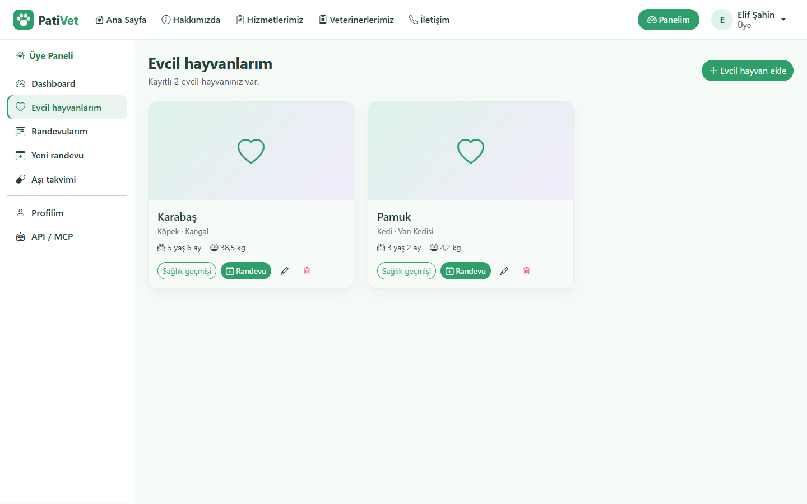 |
| **Randevu sihirbazı** (uygun saatler API'den canlı gelir) 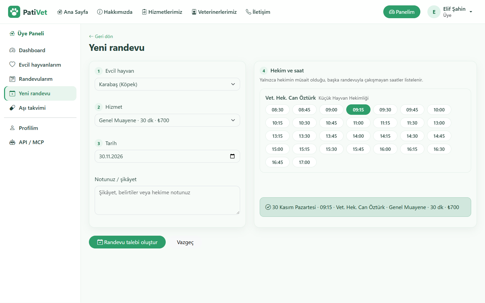 | **Aşı takvimi** 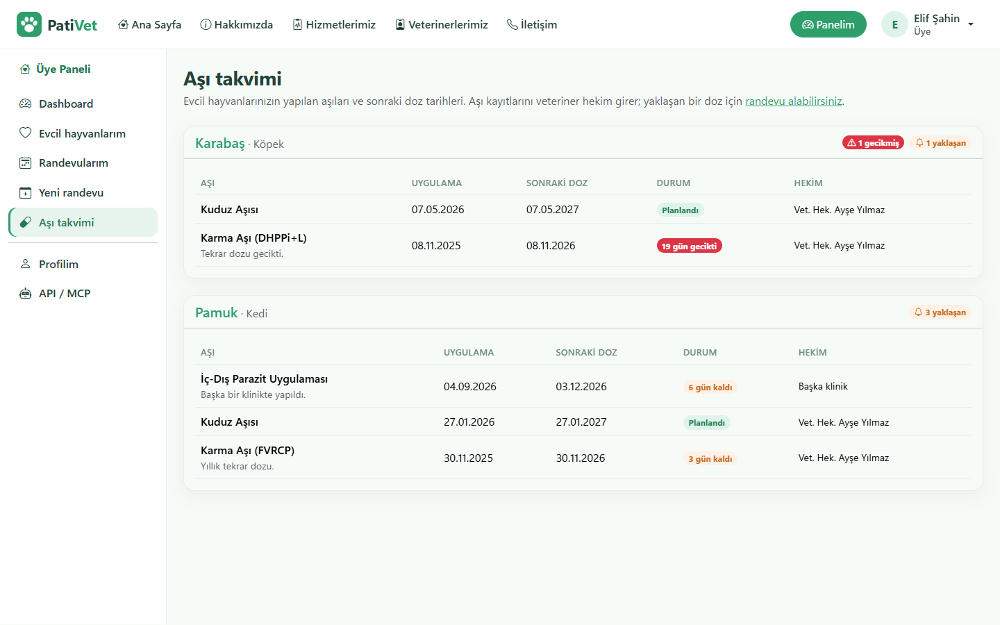 |
| **Veteriner paneli** 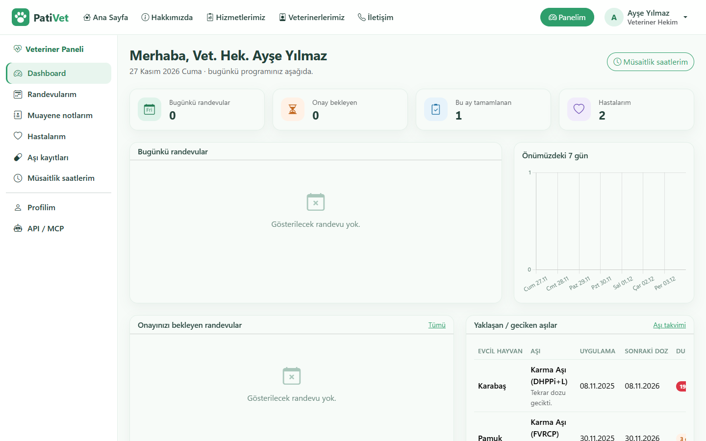 | **Veteriner randevuları** 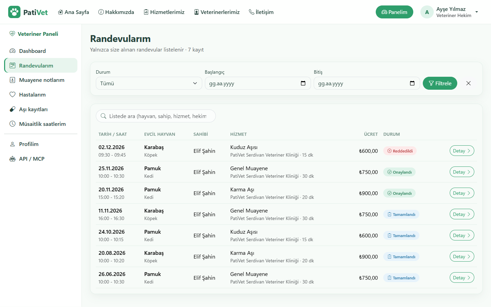 |
| **Yönetim paneli** 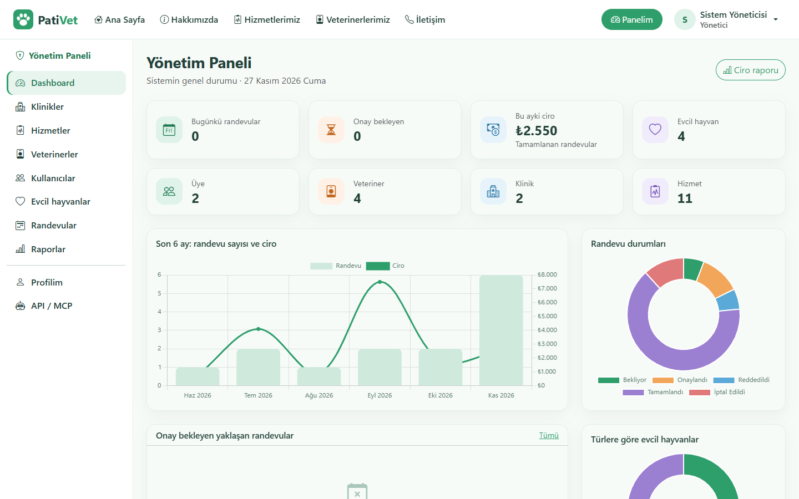 | **Ciro raporu** (REST API + LINQ) 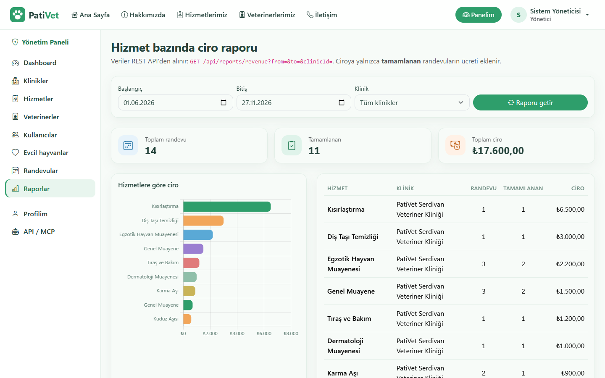 |

**Mobil görünüm:** tablolar küçük ekranda kart listesine dönüşür.

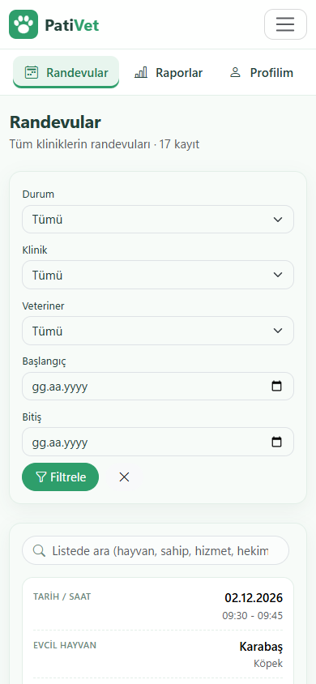

### Arayüz özellikleri

- Role göre kenar menülü panel düzeni (mobilde yatay kayan menü), istatistik kartları ve Chart.js grafikleri
- İşlem sonuçları sağ üstte **toast bildirimi**; silme/iptal/kilitleme gibi geri alınamaz işlemler için **onay penceresi (modal)**
- Listelerde anında **hızlı arama**, randevu listelerinde durum/klinik/hekim/tarih filtreleri
- Form gönderilirken buton kilitlenir ("İşleniyor..."), çift tıklamayla iki kayıt oluşmaz
- Boş durum (kayıt yok), hata (404/403) ve yükleniyor durumları için ayrı tasarımlar
- İstemci tarafı doğrulama mesajları Türkçe; sunucu tarafı kurallarla aynı

## Geliştirme süreci

Proje aşamalar hâlinde geliştirildi; plan ve gün gün yapılanlar: [docs/gelistirme-plani.md](docs/gelistirme-plani.md).
