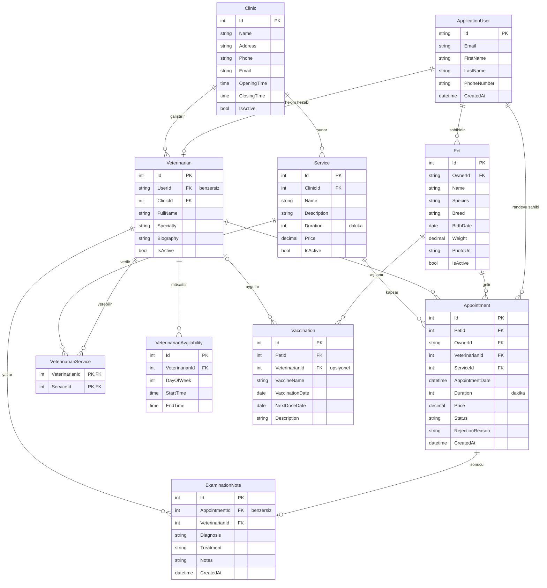
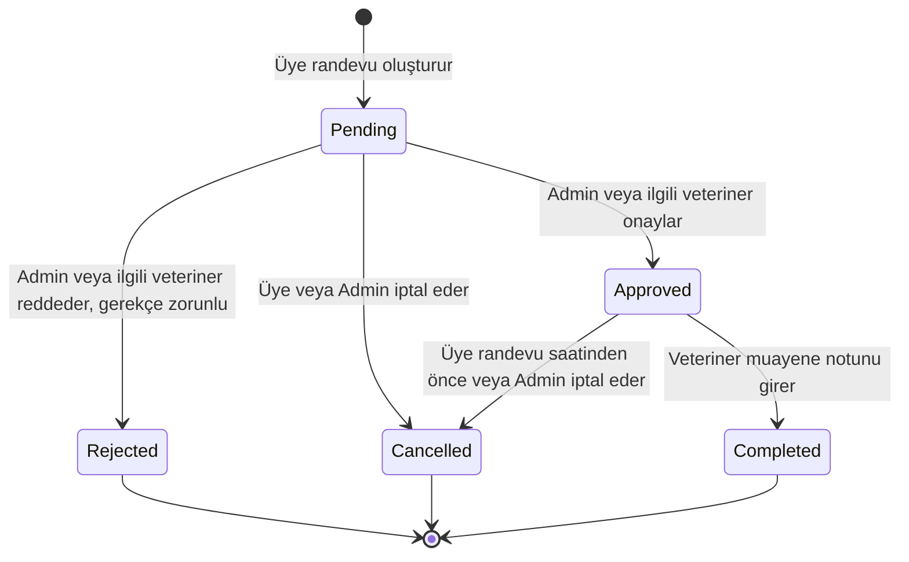
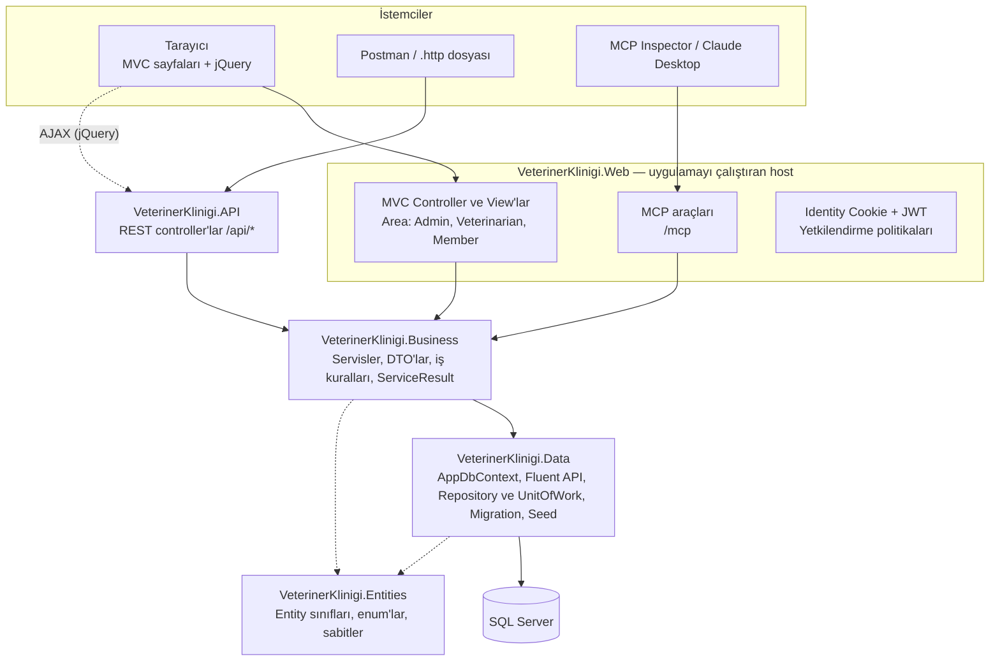
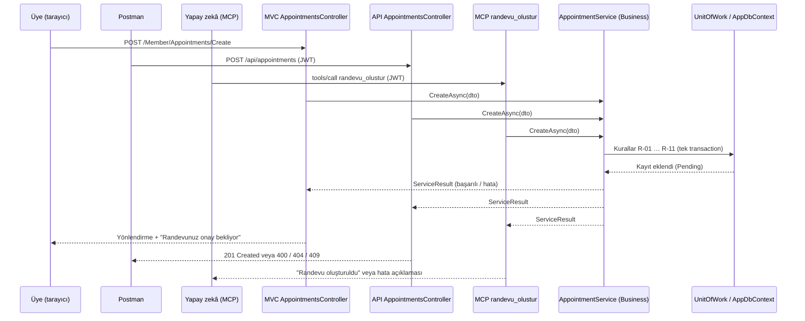

# Aşama 1 — Gereksinim Analizi ve Mimari Tasarım

> **Proje:** Veteriner Kliniği Randevu ve Hasta Takip Sistemi (PatiVet)
> **Ders:** Web Programlama — 2026-2027 Güz Dönemi
> **Bu dokümanın amacı:** Kod yazmaya başlamadan önce ödevde istenen her maddeyi tek tek çıkarmak, bunları modüllere ve aşamalara dağıtmak, veritabanını ve katmanlı mimariyi tasarlamak. Sonraki tüm aşamalar bu dokümandaki kararlara göre geliştirilir.

---

## İçindekiler

1. [Projenin özeti](#1-projenin-özeti)
2. [Gereksinim analizi](#2-gereksinim-analizi)
3. [Roller ve yetki matrisi](#3-roller-ve-yetki-matrisi)
4. [Veritabanı tasarımı ve ER diyagramı](#4-veritabanı-tasarımı-ve-er-diyagramı)
5. [İş kuralları](#5-iş-kuralları)
6. [Yazılım mimarisi](#6-yazılım-mimarisi)
7. [Kimlik doğrulama ve güvenlik tasarımı](#7-kimlik-doğrulama-ve-güvenlik-tasarımı)
8. [REST API tasarımı](#8-rest-api-tasarımı)
9. [MCP sunucusu tasarımı](#9-mcp-sunucusu-tasarımı)
10. [Sayfa haritası](#10-sayfa-haritası)
11. [Mimari kararlar ve gerekçeleri](#11-mimari-kararlar-ve-gerekçeleri)
12. [Riskler ve önlemler](#12-riskler-ve-önlemler)

---

## 1. Projenin özeti

PatiVet; bir veya birden fazla veteriner kliniğinin **hizmetlerini**, **veteriner hekimlerini**, hekimlerin **müsaitlik saatlerini**, evcil hayvanların **aşı ve muayene geçmişini** ve hayvan sahiplerinin **randevularını** yöneten bir ASP.NET Core MVC web uygulamasıdır.

Uygulamaya üç farklı kanaldan erişilir ve üçü de **aynı iş kurallarını** kullanır:

| Kanal | Kim kullanır? | Örnek |
|---|---|---|
| **MVC arayüzü** | Tarayıcıdaki Admin, Veteriner ve Üye | "Yeni Randevu" formu |
| **REST API** (`/api/...`) | Postman, `.http` dosyası, sayfadaki jQuery kodları | `GET /api/appointments/available-slots` |
| **MCP sunucusu** (`/mcp`) | MCP Inspector, Claude Desktop, VS Code gibi yapay zekâ istemcileri | "Pamuk'un bir sonraki aşısı ne zaman?" → `asi_takvimi("Pamuk")` |

---

## 2. Gereksinim analizi

### 2.1 Fonksiyonel gereksinimler

Her gereksinime bir kod verdik (FG-xx). "Aşama" sütunu, gereksinimin hangi geliştirme aşamasında karşılanacağını gösterir.

| Kod | Gereksinim | Ödevdeki kaynak | Aşama |
|---|---|---|---|
| FG-01 | Klinik tanımlama (ad, adres, iletişim, çalışma saatleri) ve CRUD | Konsept 1 | 3, 7 |
| FG-02 | Kliniğe ait hizmetler (muayene, aşı, kısırlaştırma, diş temizliği, tıraş/bakım…), **süre** ve **ücret** bilgisiyle CRUD | Konsept 1 | 3, 7 |
| FG-03 | Veteriner hekim tanımlama, uzmanlık alanı, verebildiği hizmetler | Konsept 2 | 3, 7 |
| FG-04 | Hekim müsaitlik saatleri (gün + başlangıç/bitiş); randevular yalnızca bu aralıklara alınabilir | Konsept 2 | 7, 8 |
| FG-05 | Üye kaydı ve girişi | Konsept 3, Beklenenler | 5 |
| FG-06 | Üyenin birden fazla evcil hayvan kaydetmesi (tür, ırk, doğum tarihi, kilo, isteğe bağlı fotoğraf) | Konsept 3 | 7 |
| FG-07 | Evcil hayvan aşı kayıtları (aşı adı, yapılış tarihi, sonraki doz tarihi) | Konsept 3 | 7 |
| FG-08 | Tamamlanan randevu için hekimin muayene notu girmesi | Konsept 3 | 8 |
| FG-09 | Hayvan + hizmet + hekim seçerek randevu alma | Konsept 4 | 8 |
| FG-10 | Hekim müsaitliği ve önceki randevulara göre uygunluk kontrolü; **hizmet süresi çakışma hesabına dahil** | Konsept 4 | 8 |
| FG-11 | Randevu detaylarının (hizmet, süre, ücret, hekim, hayvan, tarih/saat) saklanması | Konsept 4 | 3, 8 |
| FG-12 | Onay mekanizması: randevu **Bekliyor** durumunda oluşur, Admin veya ilgili veteriner onaylar/reddeder | Konsept 4 | 8 |
| FG-13 | REST API ile veritabanı iletişimi, LINQ ile filtreleme | Konsept 5 | 9 |
| FG-14 | API'nin entity yerine **DTO** döndürmesi ve doğru HTTP durum kodları (200, 201, 400, 404…) | Konsept 5 | 9 |
| FG-15 | Hizmet türüne göre randevu sayısı ve ciro raporu | Konsept 5 | 9, 11 |
| FG-16 | En az 3 araçlı MCP sunucusu, en az biri veri yazan | Konsept 6 | 10 |
| FG-17 | MCP araçlarının MVC ve API ile **aynı servis katmanını** kullanması | Konsept 6 | 6, 10 |
| FG-18 | MCP ucunun yetkilendirme ile korunması, araçların sadece ilgili kullanıcının verisini döndürmesi | Konsept 6 | 10 |
| FG-19 | Admin paneli (yönetim + istatistik) | Beklenenler | 7, 11 |
| FG-20 | En az 3 rol: Admin, Veteriner, Üye | Beklenenler | 5 |
| FG-21 | Admin hesabı: `ogrencinumarasi@sakarya.edu.tr` / `sau` | Beklenenler | 5 |
| FG-22 | Bir üyenin URL'deki id'yi değiştirerek başka üyenin verisini görememesi | Beklenenler | 6, 7, 12 |
| FG-23 | Tüm temel varlıklar için tam CRUD (Klinik, Hizmet, Veteriner, Evcil Hayvan, Aşı, Randevu) | Beklenenler | 7, 8 |
| FG-24 | İstemci + sunucu tarafı doğrulama (validation) | Beklenenler | 7, 12 |
| FG-25 | Front-end (Bootstrap 5 tema) | Beklenenler | 2, 11 |

### 2.2 Fonksiyonel olmayan gereksinimler

| Kod | Kategori | Gereksinim | Nasıl karşılanacak? |
|---|---|---|---|
| FOG-01 | Güvenlik | Parolalar güvenli saklanmalı | ASP.NET Core Identity parola hash'i (PBKDF2), parola politikası, hesap kilitleme |
| FOG-02 | Güvenlik | SQL Injection'a karşı koruma | Tüm sorgular EF Core + LINQ ile parametreli; ham SQL birleştirme yok |
| FOG-03 | Güvenlik | XSS'e karşı koruma | Razor'ın otomatik HTML encode'u; kullanıcı verisinde `Html.Raw` kullanılmaz |
| FOG-04 | Güvenlik | CSRF'e karşı koruma | Tüm MVC POST'larında anti-forgery token (global filtre) |
| FOG-05 | Güvenlik | Gizli bilgiler depoya girmemeli | `dotnet user-secrets` (JWT anahtarı, gerekirse SQL parolası) |
| FOG-06 | Güvenlik | Güvenli dosya yükleme | Uzantı + boyut + dosya imzası (magic bytes) kontrolü, rastgele dosya adı |
| FOG-07 | Tutarlılık | İş kuralları tek yerde | Business katmanı; MVC, API ve MCP aynı servisi çağırır |
| FOG-08 | Veri bütünlüğü | Geçmiş sağlık ve randevu kayıtları kaybolmamalı | Silme yerine arşivleme (`IsActive`), `DeleteBehavior.Restrict` |
| FOG-09 | Performans | Gereksiz veri çekilmemeli | `AsNoTracking`, DTO'ya `Select` ile projeksiyon, index'ler |
| FOG-10 | Kullanılabilirlik | Mobil uyumlu, anlaşılır Türkçe arayüz | Bootstrap 5 grid, Türkçe doğrulama ve Identity hata mesajları |
| FOG-11 | Sürdürülebilirlik | Katmanlı, test edilebilir yapı | 5 proje, Dependency Injection, arayüz (interface) tabanlı servisler |

### 2.3 Teslim ve GitHub kuralları (kontrol listesi)

- [ ] GitHub'da **herkese açık (public)** depo
- [ ] **İlk commit'te** projeyi kısaca anlatan `README.md`
- [ ] **En az 10 farklı günde** en az 10 commit (plan: [`gelistirme-plani.md`](gelistirme-plani.md))
- [ ] Bağlantı dizesi parolaları ve API anahtarları depoda **yok**
- [ ] Rapor = kök dizindeki `README.md` (başta: proje başlığı, öğrenci no, ad soyad, ders grubu, GitHub bağlantısı)
- [ ] README'de: tanıtım, ER diyagramı, ekran görüntüleri, REST API uçları + örnek istek/cevap, MCP araçları + MCP istemcisinden çağrı ekran görüntüsü
- [ ] SABİS'e 3 satırlık `.txt` (öğrenci no / ad soyad / GitHub adresi)
- [ ] Son teslim tarihinden sonra depoda değişiklik yok

---

## 3. Roller ve yetki matrisi

Sistemde üç rol vardır. Rol adları veritabanında ASCII karakterle tutulur, arayüzde Türkçe gösterilir.

| Rol sabiti | Veritabanındaki ad | Arayüzde |
|---|---|---|
| `RoleNames.Admin` | `Admin` | Yönetici |
| `RoleNames.Veterinarian` | `Veteriner` | Veteriner Hekim |
| `RoleNames.Member` | `Uye` | Üye (Hayvan Sahibi) |

### 3.1 Yetki matrisi

✅ = tam yetki, 🔒 = sadece kendi kaydı / ilişkili kaydı, 👁 = sadece görüntüleme, ❌ = yetki yok

| İşlem | Admin | Veteriner | Üye |
|---|:-:|:-:|:-:|
| Yönetim paneli | ✅ | ❌ | ❌ |
| Klinik CRUD | ✅ | ❌ | ❌ |
| Hizmet CRUD | ✅ | ❌ | ❌ |
| Veteriner CRUD (+ verdiği hizmetler) | ✅ | ❌ | ❌ |
| Müsaitlik saatleri CRUD | ✅ | 🔒 kendi saatleri | ❌ |
| Kullanıcı yönetimi (listele, kilitle/aç) | ✅ | ❌ | ❌ |
| Profil düzenleme / parola değiştirme | 🔒 | 🔒 | 🔒 |
| Evcil hayvan ekle/düzenle/sil | ✅ | ❌ | 🔒 kendi hayvanları |
| Evcil hayvan sağlık geçmişi | ✅ | 🔒 randevusu olan hayvanlar | 🔒 kendi hayvanları |
| Aşı kaydı ekle/düzenle/sil | ✅ | 🔒 randevusu olan hayvanlar | ❌ |
| Aşı takvimini görüntüleme | ✅ | 🔒 | 🔒 kendi hayvanları |
| Randevu oluşturma | ✅ | ❌ | 🔒 kendi hayvanı için |
| Randevu güncelleme (sadece *Bekliyor* durumunda) | ✅ | ❌ | 🔒 |
| Randevu iptal | ✅ | ❌ | 🔒 |
| Randevu onay / ret | ✅ | 🔒 kendisine ait | ❌ |
| Muayene notu girme (randevuyu tamamlama) | ❌ | 🔒 kendisine ait | ❌ |
| Muayene notu görüntüleme | ✅ | 🔒 | 👁 kendi hayvanının |
| Raporlar ve istatistikler | ✅ | 🔒 kendi istatistikleri | 🔒 kendi özeti |

### 3.2 Sahiplik (resource-based authorization) kuralları

Rol kontrolü ("bu kişi Üye mi?") tek başına yetmez. Ödevin özellikle istediği gibi, kullanıcı URL'deki id'yi değiştirdiğinde başkasının verisine ulaşamamalıdır. Bu yüzden **her sorgu, giriş yapmış kullanıcıya göre filtrelenir**:

| Kaynak | Admin | Veteriner | Üye |
|---|---|---|---|
| `Pet` | Hepsi | `Appointments.Any(a => a.VeterinarianId == benimVetId)` | `OwnerId == benimUserId` |
| `Appointment` | Hepsi | `VeterinarianId == benimVetId` | `OwnerId == benimUserId` |
| `Vaccination` | Hepsi | Erişebildiği hayvanınkiler | Kendi hayvanınınkiler |
| `ExaminationNote` | Hepsi | Kendi yazdıkları | Kendi hayvanının randevularına ait olanlar |
| `VeterinarianAvailability` | Hepsi | Kendine ait | Okuma (randevu ekranı için) |

**Önemli tasarım kararı:** Sahibi olmadığı bir kayda erişmeye çalışan kullanıcıya `403 Forbidden` yerine **`404 Not Found`** döneriz. Böylece saldırgan "bu id'de bir kayıt var ama benim değil" bilgisini de öğrenemez (id tahmin etme / enumeration saldırısını zorlaştırır).

Bu filtreler **Business katmanındaki servislerin içinde** uygulanır. Böylece MVC, API ve MCP aynı korumayı otomatik olarak alır; kontrolü üç ayrı yerde yazmayız.

---

## 4. Veritabanı tasarımı ve ER diyagramı

### 4.1 Tablolar ve alanlar

Tip sütunundaki `TimeOnly` / `DateOnly`, .NET'in sadece saat / sadece tarih tipleridir; SQL Server'da `time` ve `date` kolonlarına karşılık gelir.

#### ApplicationUser (Identity'nin `AspNetUsers` tablosu)

`IdentityUser`'dan miras alır (Id, Email, UserName, PasswordHash, PhoneNumber, LockoutEnd… hazır gelir). Eklediğimiz alanlar:

| Alan | Tip | Kural |
|---|---|---|
| FirstName | string(50) | Zorunlu |
| LastName | string(50) | Zorunlu |
| CreatedAt | DateTime | Kayıt tarihi |
| FullName | — | Hesaplanan özellik (veritabanına yazılmaz) |

#### Clinic

| Alan | Tip | Kural |
|---|---|---|
| Id | int | PK |
| Name | string(100) | Zorunlu |
| Address | string(250) | Zorunlu |
| Phone | string(20) | Zorunlu |
| Email | string(100) | Geçerli e-posta |
| Description | string(1000) | Opsiyonel |
| OpeningTime | TimeOnly | Zorunlu |
| ClosingTime | TimeOnly | `OpeningTime`'dan büyük olmalı |
| IsActive | bool | Arşivleme bayrağı |

#### Veterinarian

| Alan | Tip | Kural |
|---|---|---|
| Id | int | PK |
| UserId | string | FK → AspNetUsers, **benzersiz** (bir kullanıcı = en fazla bir hekim kaydı) |
| ClinicId | int | FK → Clinic |
| FullName | string(100) | Unvanlı görünen ad (ör. "Vet. Hek. Ayşe Yılmaz") |
| Specialty | string(100) | Uzmanlık alanı (küçük hayvan, egzotik, cerrahi, dermatoloji…) |
| Biography | string(2000) | Opsiyonel |
| IsActive | bool | Arşivleme bayrağı |

#### Service

| Alan | Tip | Kural |
|---|---|---|
| Id | int | PK |
| ClinicId | int | FK → Clinic |
| Name | string(100) | Zorunlu; aynı klinikte benzersiz |
| Description | string(500) | Opsiyonel |
| Duration | int | **Dakika** cinsinden, 5–480 |
| Price | decimal(10,2) | ≥ 0, TL |
| IsActive | bool | Arşivleme bayrağı |

#### VeterinarianService (çoka-çok ara tablo)

| Alan | Tip | Kural |
|---|---|---|
| VeterinarianId | int | PK + FK |
| ServiceId | int | PK + FK |

#### VeterinarianAvailability

| Alan | Tip | Kural |
|---|---|---|
| Id | int | PK |
| VeterinarianId | int | FK |
| DayOfWeek | `System.DayOfWeek` | 0 = Pazar … 6 = Cumartesi |
| StartTime | TimeOnly | Klinik açılış saatinden önce olamaz |
| EndTime | TimeOnly | `StartTime`'dan büyük, klinik kapanışından sonra olamaz |

Aynı güne birden fazla aralık girilebilir (ör. 09:00–12:00 ve 13:00–17:00 → öğle arası). Aynı hekimin aynı gündeki aralıkları çakışamaz.

#### Pet

| Alan | Tip | Kural |
|---|---|---|
| Id | int | PK |
| OwnerId | string | FK → AspNetUsers |
| Name | string(50) | Zorunlu |
| Species | `PetSpecies` enum | Kedi, Köpek, Kuş, Tavşan, Kemirgen, Sürüngen, Diğer |
| Breed | string(50) | Opsiyonel |
| BirthDate | DateOnly | Gelecek tarih olamaz |
| Weight | decimal(5,2) | kg, 0,01–150 |
| PhotoUrl | string(260) | Opsiyonel, sunucunun ürettiği yol |
| IsActive | bool | Arşivleme bayrağı |
| CreatedAt | DateTime | |

#### Vaccination

| Alan | Tip | Kural |
|---|---|---|
| Id | int | PK |
| PetId | int | FK → Pet |
| VeterinarianId | int? | FK → Veterinarian (aşıyı uygulayan; başka klinikte yapılmışsa boş) |
| VaccineName | string(100) | Zorunlu |
| VaccinationDate | DateOnly | Gelecek tarih olamaz |
| NextDoseDate | DateOnly? | Varsa `VaccinationDate`'ten sonra olmalı |
| Description | string(500) | Opsiyonel |
| CreatedAt | DateTime | |

#### Appointment

| Alan | Tip | Kural |
|---|---|---|
| Id | int | PK |
| PetId | int | FK → Pet |
| OwnerId | string | FK → AspNetUsers (hayvanın sahibinden kopyalanır; sahiplik sorgularını hızlandırır) |
| VeterinarianId | int | FK → Veterinarian |
| ServiceId | int | FK → Service |
| AppointmentDate | DateTime | Randevu **başlangıcı** (klinik yerel saati) |
| Duration | int | Dakika — oluşturma anında hizmetten **kopyalanır** |
| Price | decimal(10,2) | TL — oluşturma anında hizmetten **kopyalanır** |
| Status | `AppointmentStatus` enum | Pending, Approved, Rejected, Completed, Cancelled |
| OwnerNote | string(500) | Hayvan sahibinin notu / şikâyeti (opsiyonel) |
| RejectionReason | string(500) | Sadece *Rejected* durumunda zorunlu |
| CreatedAt | DateTime | |

> **Neden Duration ve Price randevuya kopyalanıyor?** Admin bir hizmetin fiyatını ileride değiştirirse eski randevuların ücreti ve ciro raporu bozulmasın diye. Randevu, oluşturulduğu andaki fiyatı ve süreyi saklar (anlık görüntü / *snapshot*).

#### ExaminationNote

| Alan | Tip | Kural |
|---|---|---|
| Id | int | PK |
| AppointmentId | int | FK → Appointment, **benzersiz** (bir randevuya bir not) |
| VeterinarianId | int | FK → Veterinarian |
| Diagnosis | string(500) | Zorunlu (tanı) |
| Treatment | string(1000) | Zorunlu (tedavi) |
| Notes | string(2000) | Opsiyonel |
| CreatedAt | DateTime | |

### 4.2 ER diyagramı

> GitHub, ` ```mermaid ` bloklarını otomatik olarak diyagrama çevirir.



Identity ayrıca `AspNetRoles`, `AspNetUserRoles`, `AspNetUserClaims`, `AspNetUserLogins`, `AspNetUserTokens`, `AspNetRoleClaims` tablolarını oluşturur. Bunlar diyagramda sadeleştirme için gösterilmemiştir.

### 4.3 İlişkiler ve silme davranışları

EF Core'da varsayılan silme davranışı, zorunlu ilişkilerde **Cascade**'dir (ana kayıt silinince bağlı kayıtlar da silinir). Bu, sağlık geçmişinin yanlışlıkla silinmesine yol açabileceği için çoğu ilişkiyi **Restrict** yapıyoruz:

| İlişki | Silme davranışı | Neden? |
|---|---|---|
| Clinic → Veterinarian, Service | Restrict | Hekimi/hizmeti olan klinik silinemez |
| Pet → Appointment, Vaccination | Restrict | Sağlık geçmişi korunur |
| Veterinarian → Appointment, ExaminationNote | Restrict | Randevu geçmişi korunur |
| Service → Appointment | Restrict | Ciro raporu bozulmaz |
| Appointment → ExaminationNote | Restrict | Muayene notu korunur |
| ApplicationUser → Pet, Appointment, Veterinarian | Restrict | Kullanıcı silinince veriler kaybolmaz |
| Veterinarian → VeterinarianService, VeterinarianAvailability | **Cascade** | Bunlar hekimin "ayarlarıdır", tek başlarına anlamı yoktur |
| Service → VeterinarianService | **Cascade** | Ara tablo kaydıdır |
| Veterinarian → Vaccination | **SetNull** | Hekim silinse de aşı kaydı kalır |

### 4.4 Index'ler

| Tablo | Index | Amaç |
|---|---|---|
| Appointment | (VeterinarianId, AppointmentDate) | Çakışma kontrolü ve uygun saat hesaplama (en sık sorgu) |
| Appointment | (OwnerId, AppointmentDate) | "Randevularım" listesi |
| Appointment | (PetId), (Status) | Hayvan geçmişi, durum filtreleri |
| Pet | (OwnerId) | "Evcil hayvanlarım" |
| Vaccination | (PetId), (NextDoseDate) | Aşı geçmişi, yaklaşan aşılar |
| VeterinarianAvailability | (VeterinarianId, DayOfWeek) | Uygun saat hesaplama |
| Veterinarian | (UserId) **UNIQUE** | 1 kullanıcı = 1 hekim |
| Service | (ClinicId, Name) **UNIQUE** | Aynı klinikte aynı isimde iki hizmet olmaz |
| ExaminationNote | (AppointmentId) **UNIQUE** | 1 randevu = 1 muayene notu |

---

## 5. İş kuralları

### 5.1 Randevu oluşturma kuralları

Aşağıdaki kurallar `AppointmentService.CreateAsync` metodunda **tek bir yerde** uygulanır; MVC formu, `POST /api/appointments` ve `randevu_olustur` MCP aracı bu metodu çağırır.

| Kod | Kural | Hata türü |
|---|---|---|
| R-01 | Evcil hayvan var, aktif ve **giriş yapan kullanıcıya ait** olmalı (Admin hariç) | 404 |
| R-02 | Hizmet var ve aktif olmalı | 404 |
| R-03 | Veteriner var ve aktif olmalı | 404 |
| R-04 | Veteriner seçilen hizmeti **verebilmeli** (`VeterinarianService` kaydı) | 400 |
| R-05 | Randevu **gelecekte** olmalı (geçmiş tarih/saat reddedilir) | 400 |
| R-06 | Randevu en fazla **60 gün** sonrasına alınabilir (ayarlanabilir) | 400 |
| R-07 | Başlangıç saati **15 dakikalık** aralıklara denk gelmeli (10:00, 10:15, 10:30…) | 400 |
| R-08 | `[başlangıç, başlangıç + hizmet süresi]` aralığı, hekimin o günkü **bir müsaitlik aralığının tamamen içinde** olmalı | 400 |
| R-09 | Aralık, kliniğin çalışma saatleri içinde olmalı | 400 |
| R-10 | Hekimin *Bekliyor / Onaylandı / Tamamlandı* durumundaki randevularıyla **çakışmamalı** | 409 |
| R-11 | Aynı evcil hayvanın aynı saatte başka bir aktif randevusu olmamalı | 409 |
| R-12 | Kontrol + kayıt işlemi tek bir **veritabanı transaction**'ı içinde yapılır (aynı anda gelen iki istek aynı saati kapamasın) | — |
| R-13 | Kayıt: `Status = Pending`, `Duration` ve `Price` hizmetten kopyalanır, `OwnerId` hayvanın sahibinden alınır | — |

### 5.2 Çakışma kontrolü algoritması

Sadece başlangıç saatlerini karşılaştırmak **yanlıştır**. İki zaman aralığı `[b1, s1)` ve `[b2, s2)` (b = başlangıç, s = bitiş) ancak ve ancak şu koşulda çakışır:

```text
b1 < s2  VE  b2 < s1
```

Örnek — mevcut randevu **10:00–10:30**:

| Yeni randevu | `b1 < s2`? | `b2 < s1`? | Sonuç |
|---|---|---|---|
| 10:15–10:45 | 10:15 < 10:30 ✔ | 10:00 < 10:45 ✔ | ❌ **Çakışıyor** |
| 09:45–10:15 | 09:45 < 10:30 ✔ | 10:00 < 10:15 ✔ | ❌ **Çakışıyor** |
| 09:30–11:00 (uzun hizmet) | 09:30 < 10:30 ✔ | 10:00 < 11:00 ✔ | ❌ **Çakışıyor** |
| 10:30–11:00 | 10:30 < 10:30 ✘ | — | ✅ Uygun (arka arkaya) |
| 09:30–10:00 | 09:30 < 10:30 ✔ | 10:00 < 10:00 ✘ | ✅ Uygun (arka arkaya) |

Bitiş saati `AppointmentDate + Duration` ile hesaplanır. Böylece hizmet süresi çakışma hesabına dahil olur (ödevin özellikle istediği nokta).

### 5.3 Uygun saatlerin (slot) hesaplanması

`GetAvailableSlotsAsync(hizmetId, tarih, veterinerId?)`:

1. Hizmeti bul → süresini al (ör. 30 dk).
2. Bu hizmeti verebilen **aktif** hekimleri bul (veteriner seçildiyse sadece onu).
3. Seçilen tarihin haftanın hangi günü olduğunu bul, hekimlerin o günkü müsaitlik aralıklarını getir.
4. O günkü aktif randevuları **tek bir sorguyla** çek (hekim başına ayrı sorgu atmamak için).
5. Her aralık için başlangıçtan itibaren 15'er dakika ilerle; `aday + süre ≤ aralık sonu` olduğu sürece:
   - aday geçmişte değilse **ve**
   - hiçbir mevcut randevuyla çakışmıyorsa (5.2'deki formül) → uygun saat listesine ekle.
6. Sonuç: `[{ veterinerId, veterinerAdi, saatler: ["09:00", "09:15", …] }]`

Aynı algoritma; randevu formundaki saat seçimi (jQuery → API), `GET /api/appointments/available-slots` ve `uygun_saatler` MCP aracı tarafından kullanılır.

### 5.4 Randevu durum makinesi



| Durum | Türkçe | Saat dolu sayılır mı? |
|---|---|---|
| Pending | Bekliyor | ✅ Evet (onay beklerken başkası alamaz) |
| Approved | Onaylandı | ✅ Evet |
| Completed | Tamamlandı | ✅ Evet |
| Rejected | Reddedildi | ❌ Hayır, saat boşa çıkar |
| Cancelled | İptal edildi | ❌ Hayır, saat boşa çıkar |

- Randevu **sadece *Bekliyor*** durumundayken sahibi tarafından güncellenebilir (tarih/saat/hekim). Güncellemede R-01…R-11 kuralları **kendisi hariç** yeniden çalışır.
- *Tamamlandı* durumuna geçiş, muayene notu girilerek yapılır ve randevu saati gelmiş olmalıdır.

### 5.5 Silme ve arşivleme kuralları

"Geçmiş sağlık ve randevu kayıtlarının yanlışlıkla kaybolmasını önle" gereksinimi için:

| Varlık | Bağlı kaydı **yoksa** | Bağlı kaydı **varsa** |
|---|---|---|
| Klinik | Silinir | Silinmez → "Pasif yap" önerilir |
| Hizmet | Silinir | Arşivlenir (`IsActive = false`), yeni randevuda listelenmez |
| Veteriner | Silinir (müsaitlik ve hizmet eşleşmeleri ile birlikte) | Arşivlenir, yeni randevu alamaz |
| Evcil hayvan | Silinir (fotoğrafı da silinir) | Arşivlenir; aşı ve randevu geçmişi korunur |
| Aşı kaydı | Silinir (Veteriner/Admin, hatalı kaydı düzeltmek için) | — |
| Randevu | Üye silemez, **iptal eder**. Admin sadece *İptal/Reddedildi* durumundaki ve muayene notu olmayan randevuyu silebilir | — |
| Muayene notu | Silinmez, sadece yazan hekim düzenleyebilir | — |

### 5.6 Diğer doğrulama kuralları

- Müsaitlik aralığı: `StartTime < EndTime`, klinik saatleri içinde, aynı gün için çakışmayan aralıklar.
- Aşı: `VaccinationDate ≤ bugün`, `NextDoseDate > VaccinationDate`.
- Evcil hayvan: `BirthDate ≤ bugün`, kilo 0,01–150 kg.
- Fotoğraf: sadece `.jpg .jpeg .png .webp`, en fazla 2 MB, dosya imzası kontrolü, adı sunucuda `Guid` ile üretilir.
- Ret işleminde `RejectionReason` zorunlu (en az 5 karakter).

---

## 6. Yazılım mimarisi

### 6.1 Katmanlar



| Proje | Türü | Sorumluluğu | Neyi **bilmez**? |
|---|---|---|---|
| **Entities** | Class Library | Veritabanı tablolarına karşılık gelen sınıflar, enum'lar (`AppointmentStatus`, `PetSpecies`), rol sabitleri | EF Core, HTTP, arayüz |
| **Data** | Class Library | `AppDbContext`, Fluent API ayarları, generic Repository + UnitOfWork, migration'lar, seed | İş kuralları, HTTP |
| **Business** | Class Library | Servisler (`IAppointmentService` vb.), DTO'lar, iş kuralları, sahiplik filtreleri, `ServiceResult` | HTTP, View, JSON, MCP |
| **API** | Class Library (ASP.NET Core framework referanslı) | `[ApiController]` sınıfları, DTO ↔ HTTP durum kodu dönüşümü, JWT üretimi | Razor View |
| **Web** | ASP.NET Core MVC (çalıştırılan proje) | `Program.cs` (her şeyin bağlandığı yer), MVC controller/view'lar, Area'lar, MCP araçları, Identity ayarları, dosya yükleme | — |

### 6.2 Proje referansları (bağımlılık yönü)

```text
Web ──► API ──► Business ──► Data ──► Entities
 │                 ▲           ▲
 └─────────────────┴───────────┘   (Web, servisleri ve DbContext'i kaydetmek için doğrudan da referans verir)
```

Kural: **Oklar her zaman aşağı doğrudur.** Entities hiçbir projeye, Data sadece Entities'e bağımlıdır. Böylece örneğin Business katmanı "tarayıcı" veya "HTTP" kavramlarından habersizdir; bu sayede aynı servis MCP aracından da çağrılabilir.

### 6.3 Klasör yapısı (hedef)

```text
VeterinerKlinigi/                         ← GitHub deposunun kökü
├── README.md
├── .gitignore
├── VeterinerKlinigi.slnx                 ← Solution dosyası (.NET 10 formatı)
├── Directory.Build.props                 ← Tüm projelerde ortak ayarlar (net10.0, nullable…)
├── Directory.Packages.props              ← Tüm NuGet sürümleri tek yerde
├── docs/                                 ← Aşama dokümanları, diyagramlar, ekran görüntüleri
└── src/
    ├── VeterinerKlinigi.Entities/
    │   ├── Constants/      (RoleNames)
    │   ├── Enums/          (AppointmentStatus, PetSpecies)
    │   └── *.cs            (ApplicationUser, Clinic, Pet, Appointment …)
    ├── VeterinerKlinigi.Data/
    │   ├── Context/        (AppDbContext)
    │   ├── Configurations/ (her entity için IEntityTypeConfiguration)
    │   ├── Repositories/   (IRepository<T>, Repository<T>, IUnitOfWork, UnitOfWork)
    │   ├── Seed/           (DbSeeder)
    │   └── Migrations/
    ├── VeterinerKlinigi.Business/
    │   ├── Common/         (ServiceResult, ErrorType, PagedResult)
    │   ├── Abstractions/   (ICurrentUserService)
    │   ├── Dtos/
    │   ├── Interfaces/     (IClinicService, IAppointmentService …)
    │   ├── Services/       (ClinicService, AppointmentService …)
    │   └── Rules/          (AppointmentRules — saf, test edilebilir çakışma fonksiyonları)
    ├── VeterinerKlinigi.API/
    │   ├── Controllers/    (VeterinariansController, AppointmentsController, ReportsController …)
    │   ├── Contracts/      (API'ye özel istek/cevap modelleri)
    │   └── Auth/           (JwtTokenService)
    └── VeterinerKlinigi.Web/
        ├── Areas/
        │   ├── Admin/         (Dashboard, Clinics, Veterinarians, Services, Owners, Pets, Appointments, Reports)
        │   ├── Veterinarian/  (Dashboard, Appointments, ExaminationNotes, Vaccinations, Availability)
        │   └── Member/        (Dashboard, Pets, Appointments, Vaccinations)
        ├── Controllers/    (Home, Account, Services, Veterinarians)
        ├── Infrastructure/ (CurrentUserService, FileStorageService, Türkçe Identity mesajları)
        ├── Mcp/            (MCP araç sınıfları)
        ├── Models/         (ViewModel'ler)
        ├── Views/
        └── wwwroot/
```

### 6.4 Bir randevunun üç kanaldan oluşturulması

Aşağıdaki diyagram, mimarinin en önemli fikrini gösterir: **üç farklı giriş kapısı, tek bir iş kuralı.**



### 6.5 Hata yönetimi

- **Beklenen hatalar** (geçmiş tarih, çakışma, kayıt bulunamadı…) exception fırlatılarak değil, `ServiceResult` nesnesi ile döndürülür:

  ```csharp
  // Business katmanı (Aşama 6'da yazılacak)
  public enum ErrorType { None, Validation, NotFound, Forbidden, Conflict }
  // ServiceResult<T> => IsSuccess, Data, ErrorType, ErrorMessage
  ```

- Her kanal bu sonucu kendi diline çevirir:

  | ErrorType | MVC | REST API | MCP |
  |---|---|---|---|
  | Validation | `ModelState` hatası, form tekrar gösterilir | `400 Bad Request` + ProblemDetails | Hata mesajı metni |
  | NotFound | 404 sayfası | `404 Not Found` | "Kayıt bulunamadı" |
  | Forbidden | Erişim reddedildi sayfası | `403 Forbidden` | Yetki hatası |
  | Conflict | `ModelState` hatası (çakışan saat açıklaması) | `409 Conflict` | Çakışma nedeni |

- **Beklenmeyen hatalar** (veritabanı kapalı vb.) global exception handler ile yakalanır, loglanır; kullanıcıya teknik detay gösterilmez.

### 6.6 Dependency Injection yaşam süreleri

| Servis | Yaşam süresi | Neden? |
|---|---|---|
| `AppDbContext` | Scoped | Her HTTP isteği için bir tane; istek bitince bağlantı kapanır |
| `IRepository<T>`, `IUnitOfWork` | Scoped | DbContext'i kullandıkları için onunla aynı ömür |
| İş servisleri (`IAppointmentService` …) | Scoped | Aynı nedenle |
| `ICurrentUserService` | Scoped | O anki isteğin kullanıcısını okur |
| `TimeProvider` | Singleton | Durumsuz; "şu an"ı veren .NET sınıfı (test ederken sahte saat verilebilir) |

---

## 7. Kimlik doğrulama ve güvenlik tasarımı

### 7.1 İki kimlik doğrulama yöntemi

| Yöntem | Kim kullanır? | Neden? |
|---|---|---|
| **Identity Cookie** | Tarayıcıdaki MVC sayfaları ve sayfadaki jQuery'nin yaptığı `GET` API çağrıları | Tarayıcıda standart oturum yöntemi |
| **JWT Bearer token** | Postman, REST istemcileri, **MCP Inspector / yapay zekâ istemcileri** | Bu istemciler çerez taşımaz; `Authorization: Bearer <token>` başlığı gönderir |

- Token iki yoldan alınır: `POST /api/auth/token` (e-posta + parola) veya giriş yaptıktan sonra **Profilim → API/MCP Erişim Anahtarı** sayfasından.
- Token içinde kullanıcı id'si, e-posta, roller ve (hekimse) `vet_id` claim'i bulunur; süresi ayarlanabilir (varsayılan 2 saat).
- JWT imzalama anahtarı **`dotnet user-secrets`** ile saklanır, depoya girmez.

### 7.2 CSRF ile API yazma işlemlerinin ilişkisi

Tarayıcı çerezi her isteğe otomatik ekler; bu yüzden çerezle yetkilendirilen yazma (POST/PUT/DELETE) işlemleri CSRF saldırısına açıktır. Bu riski şöyle kapatıyoruz:

- **MVC formları:** Global `AutoValidateAntiforgeryToken` filtresi.
- **API okuma (GET):** Çerez **veya** JWT kabul edilir (sayfadaki jQuery kullanabilsin diye).
- **API yazma (POST):** **Sadece JWT** kabul edilir. Tarayıcı JWT'yi kendiliğinden göndermediği için CSRF mümkün değildir.
- Çerez ayrıca `HttpOnly`, `Secure` ve `SameSite=Lax` olarak ayarlanır (savunma derinliği).

### 7.3 Parola politikası ve admin hesabı

- Normal kullanıcılar için: en az 8 karakter, büyük harf, küçük harf ve rakam zorunlu; 5 hatalı girişte 5 dakika kilit; e-posta benzersiz.
- Ödev, admin parolasının **`sau`** olmasını şart koşuyor. Bu parola yukarıdaki politikaya uymaz. Politikayı herkes için gevşetmek yerine **sadece seed sırasında** admin parolasını Identity'nin `PasswordHasher`'ı ile hash'leyip kaydediyoruz. Böylece:
  - Ödev şartı karşılanır,
  - Kayıt olan diğer tüm kullanıcılar güçlü parola kullanmak zorunda kalır,
  - Parola yine hash'li saklanır (düz metin değil).
- Admin e-postası `appsettings.json` içindeki `Seed:AdminEmail` ayarından okunur. **Kendi öğrenci numaranızla değiştirmeniz gerekir.**

### 7.4 Güvenlik kontrol listesi (Aşama 12'de test edilecek)

| Tehdit | Önlem |
|---|---|
| SQL Injection | EF Core parametreli sorgular, ham SQL birleştirme yok |
| XSS | Razor encode, kullanıcı verisinde `Html.Raw` yok, dosya adı sunucuda üretilir |
| CSRF | Anti-forgery token, API yazma = sadece JWT, SameSite çerez |
| IDOR (id değiştirerek erişim) | Servislerde kullanıcıya göre filtre, başkasının kaydı için 404 |
| Kaba kuvvet (brute force) | Identity hesap kilitleme |
| Zararlı dosya yükleme | Uzantı + boyut + imza kontrolü, `wwwroot/uploads` dışına yazmama, rastgele ad |
| Gizli bilgi sızıntısı | user-secrets, `.gitignore`, hata sayfasında stack trace yok (Production) |
| Aşırı veri döndürme | API ve MCP sadece DTO döndürür (PasswordHash gibi alanlar asla dışarı çıkmaz) |

---

## 8. REST API tasarımı

Tüm uçlar `/api` ile başlar, JSON döndürür, **entity değil DTO** kullanır.

| Metot | Uç | Yetki | Açıklama | Başarılı | Hatalar |
|---|---|---|---|---|---|
| POST | `/api/auth/token` | Herkes | E-posta + parola ile JWT üretir | 200 | 400, 401 |
| GET | `/api/clinics` | Herkes | Aktif klinikler | 200 | — |
| GET | `/api/services?clinicId=` | Herkes | Hizmetler (kliniğe göre LINQ filtresi) | 200 | — |
| GET | `/api/veterinarians?clinicId=&serviceId=&specialty=` | Herkes | Hekimler (LINQ filtreleri) | 200 | — |
| GET | `/api/veterinarians/{id}` | Herkes | Hekim detayı + hizmetleri + müsaitliği | 200 | 404 |
| GET | `/api/pets` | Giriş yapmış | Kullanıcının hayvanları | 200 | 401 |
| GET | `/api/pets/{id}/vaccinations` | Sahip / ilgili hekim / Admin | Geçmiş + yaklaşan aşılar | 200 | 401, 404 |
| GET | `/api/appointments?status=&from=&to=` | Giriş yapmış | Role göre filtrelenmiş randevular | 200 | 401 |
| GET | `/api/appointments/{id}` | Sahip / ilgili hekim / Admin | Randevu detayı | 200 | 401, 404 |
| GET | `/api/appointments/available-slots?serviceId=&date=&veterinarianId=` | Giriş yapmış | Uygun hekim ve saatler | 200 | 400, 404 |
| POST | `/api/appointments` | Üye/Admin (JWT) | Randevu oluşturur (*Pending*) | **201** + `Location` | 400, 401, 404, **409** |
| POST | `/api/appointments/{id}/approve` | Admin / ilgili hekim (JWT) | Onaylar | 200 | 400, 403, 404 |
| POST | `/api/appointments/{id}/reject` | Admin / ilgili hekim (JWT) | Gerekçeyle reddeder | 200 | 400, 403, 404 |
| POST | `/api/appointments/{id}/cancel` | Sahip / Admin (JWT) | İptal eder | 200 | 400, 404 |
| GET | `/api/reports/revenue?from=&to=&clinicId=` | Admin | **Hizmet türüne göre randevu sayısı ve ciro** (LINQ `GroupBy`) | 200 | 401, 403 |
| GET | `/api/reports/dashboard` | Admin | Dashboard grafik verileri | 200 | 401, 403 |

Ciro raporu taslak LINQ sorgusu (Aşama 9'da gerçek kodu yazılacak):

```csharp
var rapor = await appointments.Query()
    .Where(a => a.Status == AppointmentStatus.Completed
             && a.AppointmentDate >= from && a.AppointmentDate < to)
    .GroupBy(a => new { a.ServiceId, a.Service.Name })
    .Select(g => new ServiceRevenueDto(
        g.Key.ServiceId,
        g.Key.Name,
        g.Count(),          // randevu sayısı
        g.Sum(a => a.Price) // toplam ciro
    ))
    .OrderByDescending(x => x.TotalRevenue)
    .ToListAsync();
```

---

## 9. MCP sunucusu tasarımı

- Paket: resmî **`ModelContextProtocol.AspNetCore`** (C# MCP SDK).
- Taşıma: **Streamable HTTP**, uç: `/mcp` (Web projesinin içinde, aynı uygulama).
- Yetki: `/mcp` ucu **JWT ile korunur**; araçlar `ICurrentUserService` üzerinden giriş yapan kullanıcıyı bilir ve sadece onun verisini döndürür.
- Araçlar Business katmanındaki servisleri çağırır; **iş kuralı tekrar yazılmaz.**

| Araç | Parametreler | Okur/Yazar | Çağırdığı servis | Döndürdüğü |
|---|---|---|---|---|
| `uygun_saatler` | `hizmetId`, `tarih` (yyyy-MM-dd) | Okur | `IAppointmentService.GetAvailableSlotsAsync` | O gün boş olan hekimler ve saatleri |
| `asi_takvimi` | `hayvanAdi` | Okur (sadece kendi hayvanları) | `IVaccinationService.GetScheduleByPetNameAsync` | Geçmiş ve yaklaşan aşılar |
| `randevu_olustur` | `petId`, `serviceId`, `veterinarianId`, `appointmentDate` | **Yazar** | `IAppointmentService.CreateAsync` | Oluşan randevu veya çakışma nedeni |
| `hayvanlarim` | — | Okur | `IPetService.GetMyPetsAsync` | Kullanıcının hayvanları ve id'leri (asistanın `petId` bulması için) |
| `hizmet_listesi` | `klinikId` (ops.) | Okur | `IServiceService.GetActiveAsync` | Hizmetler, süre ve ücretleri (asistanın `hizmetId` bulması için) |

> Ödev en az 3 araç istiyor; `hayvanlarim` ve `hizmet_listesi` yardımcı araçlardır. Yapay zekâ asistanı "Pamuk için yarın aşı randevusu al" dediğinde önce bu araçlarla id'leri bulur, sonra `uygun_saatler` ve `randevu_olustur`'u çağırır.

Test: `npx @modelcontextprotocol/inspector` → Transport: *Streamable HTTP* → URL: `http://localhost:5080/mcp` → Authentication: `Bearer <token>`.

---

## 10. Sayfa haritası

| Bölüm | Sayfa | Controller / Action (plan) |
|---|---|---|
| **Genel** | Ana sayfa | `Home/Index` |
| | Hakkımızda | `Home/About` |
| | Hizmetlerimiz | `Services/Index` |
| | Veterinerlerimiz | `Veterinarians/Index`, `Veterinarians/Details/{id}` |
| | İletişim | `Home/Contact` |
| | Giriş yap / Kayıt ol / Çıkış | `Account/Login`, `Account/Register`, `Account/Logout` |
| | Profilim, Parola değiştir, API/MCP anahtarı | `Account/Profile`, `Account/ChangePassword`, `Account/ApiToken` |
| **Üye** (`/Member`) | Dashboard | `Dashboard/Index` |
| | Evcil hayvanlarım / ekle / düzenle / sil / detay | `Pets/*` |
| | Randevularım / Yeni randevu / Detay / Düzenle / İptal | `Appointments/*` |
| | Aşı takvimi | `Vaccinations/Index` |
| **Veteriner** (`/Veterinarian`) | Dashboard | `Dashboard/Index` |
| | Randevularım, Randevu detayı, Onay/Ret | `Appointments/*` |
| | Muayene notları (randevuyu tamamla) | `ExaminationNotes/*` |
| | Aşı kayıtları | `Vaccinations/*` |
| | Hasta sağlık geçmişi | `Patients/Details/{id}` |
| | Müsaitlik saatlerim | `Availability/*` |
| **Admin** (`/Admin`) | Dashboard (istatistik kartları + grafikler) | `Dashboard/Index` |
| | Klinik yönetimi | `Clinics/*` |
| | Veteriner yönetimi (+ hizmet atama, müsaitlik) | `Veterinarians/*` |
| | Hizmet yönetimi | `Services/*` |
| | Hayvan sahipleri (kullanıcılar) | `Owners/*` |
| | Evcil hayvanlar | `Pets/*` |
| | Randevu yönetimi | `Appointments/*` |
| | Raporlar (API'den Chart.js ile) | `Reports/Index` |

**Tasarım dili:** Beyaz zemin, açık yeşil (`#2E9E6B` ana renk, `#E8F5EE` pastel zemin) ve pastel tonlar; yuvarlatılmış kartlar; Bootstrap Icons; mobil uyumlu Bootstrap 5 grid. Grafikler için Chart.js.

---

## 11. Mimari kararlar ve gerekçeleri

| # | Karar | Gerekçe | Alternatif ve neden seçilmedi |
|---|---|---|---|
| K-01 | API ayrı bir **Class Library**; Web projesi tarafından barındırılıyor | Tek uygulama, tek port, ortak kimlik doğrulama; CORS gerekmez; katman ayrımı korunur | Ayrı bir Web API projesi: iki uygulama çalıştırmak, iki ayrı oturum, CORS ayarı gerekirdi |
| K-02 | MCP araçları **Web projesinde `Mcp/` klasöründe** | MCP ucu da Web host'unda yayınlanıyor; ayrı proje sadece birkaç sınıf için gereksiz karmaşa | Ayrı `VeterinerKlinigi.Mcp` projesi |
| K-03 | Generic **Repository + UnitOfWork** | Ödev planında isteniyor; veri erişimi tek tipte; transaction yönetimi tek yerde | Doğrudan DbContext kullanmak da geçerli (DbContext zaten UoW'dur). Karmaşık sorgular için `Query()` ile `IQueryable` açıyoruz |
| K-04 | Silme yerine **arşivleme** (`IsActive`) | Sağlık ve randevu geçmişi korunur | EF global query filter: zorunlu ilişkilerde geçmiş randevuları da gizleyebildiği için seçilmedi |
| K-05 | Randevuda `Duration` ve `Price` **kopyası** | Fiyat değişse de geçmiş ciro doğru kalır | Hizmet tablosundan okumak: eski raporlar bozulurdu |
| K-06 | Cookie + **JWT** | Tarayıcı için cookie, MCP Inspector/Postman için token | Sadece cookie: MCP istemcileri çerez taşımaz |
| K-07 | Enum'lar veritabanında **metin** olarak | Veritabanına bakınca "Pending" okunur, "0" değil; sunumda anlaşılır | int: daha az yer kaplar ama okunması zor |
| K-08 | Saatler **klinik yerel saati** (`DateTime`) | Tek ülke, tek saat dilimi (Türkiye UTC+3, yaz saati uygulaması yok) | UTC + dönüşüm: bu proje için gereksiz karmaşa |
| K-09 | Beklenen hatalar için **`ServiceResult`** | Exception'lar pahalıdır ve akışı gizler; üç kanal aynı sonucu kendi diline çevirir | Exception fırlatmak |
| K-10 | **Central Package Management** (`Directory.Packages.props`) | Tüm paket sürümleri tek dosyada; .NET 11 paketlerine yanlışlıkla geçilmez | Her projede ayrı sürüm: projeler arası sürüm uyumsuzluğu riski |
| K-11 | `TimeProvider` ile "şu an" | Geçmiş tarih kontrolü test edilebilir olur | `DateTime.Now`: test edilemez |

---

## 12. Riskler ve önlemler

| Risk | Etki | Önlem |
|---|---|---|
| Aynı anda iki kişinin aynı saati alması | Çift randevu | Kontrol + kayıt tek transaction (Serializable), index |
| NuGet'in .NET 11 paketlerini önermesi | Derleme hatası | `Directory.Packages.props`'ta 10.0.x sürümleri sabit |
| `sau` parolasının politikaya uymaması | Admin oluşturulamaz | Sadece seed'de hash ile kayıt (Bölüm 7.3) |
| JWT anahtarının depoya sızması | Güvenlik açığı | user-secrets + `.gitignore`; anahtar yoksa uygulama açıklayıcı hata verir |
| MCP Inspector'ın HTTPS geliştirme sertifikasına güvenmemesi | Bağlanamama | Inspector testinde `http` profili (`http://localhost:5080`) |
| 10 farklı gün şartının kaçırılması | Puan kaybı | [`gelistirme-plani.md`](gelistirme-plani.md) — her gün bir aşama, her gün commit + push |
| Sunumda kodun açıklanamaması | Puan kaybı | Her aşamanın `docs/` altında açıklama dokümanı |
