# 10 Günlük Geliştirme ve Commit Planı

Ödev şartı: **En az 10 farklı günde, en az 10 farklı commit.** Bu plan, 14 geliştirme aşamasını 10 çalışma gününe dağıtır. Her gün tek bir anlamlı iş paketi tamamlanır, test edilir, **commit edilir ve aynı gün GitHub'a push edilir.**

> Günlerin art arda olması gerekmez; önemli olan commit'lerin **10 farklı takvim gününe** yayılmasıdır. Son teslim tarihinden en az 2 gün önce bitirecek şekilde planlayın. Zaman kalırsa 10. günü ikiye bölmek (10a/10b) ekstra güvence sağlar.

## Genel bakış

```mermaid
flowchart LR
    G1["1. gün<br/>Analiz ve mimari"] --> G2["2. gün<br/>Solution yapısı"]
    G2 --> G3["3. gün<br/>Entity ve DbContext"]
    G3 --> G4["4. gün<br/>Identity ve roller"]
    G4 --> G5["5. gün<br/>Repository ve servisler"]
    G5 --> G6["6. gün<br/>CRUD modülleri"]
    G6 --> G7["7. gün<br/>Randevu ve çakışma"]
    G7 --> G8["8. gün<br/>REST API ve JWT"]
    G8 --> G9["9. gün<br/>MCP sunucusu"]
    G9 --> G10["10. gün<br/>Tasarım, test, README"]
```



## Gün gün plan

| Gün | Aşama | Yapılacaklar | Gün sonunda çalışıyor olmalı |
|:-:|---|---|---|
| **1** | 1 | GitHub deposu, README, `.gitignore`, gereksinim analizi, ER diyagramı, mimari, bu plan | Depo GitHub'da public, ER diyagramı GitHub'da görünüyor |
| **2** | 2 | Solution (`.slnx`), 5 proje, proje referansları, ortak ayarlar, merkezi paket yönetimi, temel tema, API test ucu | `dotnet build` hatasız; ana sayfa ve `/api/system/status` açılıyor |
| **3** | 3 + 4 | 10 entity, enum'lar, `AppDbContext`, Fluent API konfigürasyonları, silme davranışları, index'ler, `InitialCreate` migration | Veritabanı SQL Server'da oluştu, tablolar ve ilişkiler görünüyor |
| **4** | 5 | Identity, 3 rol, admin seed (`sau`), örnek veri seed'i, Giriş/Kayıt/Çıkış/Profil/Parola sayfaları, Türkçe Identity mesajları | Admin, örnek veteriner ve örnek üye ile giriş yapılabiliyor |
| **5** | 6 | Generic Repository + UnitOfWork, `ServiceResult`, `ICurrentUserService`, iş servisleri (Klinik, Hizmet, Veteriner, Evcil Hayvan, Aşı, Müsaitlik) ve sahiplik filtreleri | Servisler DI'a kayıtlı, uygulama açılıyor |
| **6** | 7 | Admin: Klinik/Hizmet/Veteriner CRUD; Üye: Evcil hayvan CRUD + güvenli fotoğraf yükleme; Veteriner: Aşı CRUD, müsaitlik saatleri; genel sayfalar (Hizmetlerimiz, Veterinerlerimiz, Hakkımızda, İletişim) | Tüm CRUD işlemleri veritabanında çalışıyor; id değiştirince başkasının hayvanı açılmıyor |
| **7** | 8 | `AppointmentService` (R-01…R-13), çakışma ve uygun saat algoritması, Yeni Randevu sihirbazı (jQuery ile saat seçimi), onay/ret, iptal, muayene notu, randevu listeleri | 10:00–10:30 randevusu varken 10:15'e randevu alınamıyor |
| **8** | 9 | REST API controller'ları, DTO'lar, JWT (`/api/auth/token`), ciro raporu (LINQ GroupBy), ProblemDetails, OpenAPI dokümanı, `.http` test dosyası | Postman'de tüm uçlar doğru durum kodlarıyla çalışıyor |
| **9** | 10 | MCP sunucusu (`/mcp`), `uygun_saatler`, `asi_takvimi`, `randevu_olustur`, `hayvanlarim`, `hizmet_listesi`; JWT koruması; MCP Inspector testi | MCP Inspector'dan araçlar çağrılıyor, ekran görüntüsü alındı |
| **10** | 11–14 | Admin/Veteriner/Üye dashboard'ları + Chart.js grafikleri, tasarım cilası, güvenlik test listesi, hata düzeltmeleri, **final README** (ekran görüntüleri, API örnekleri, MCP) | Teslime hazır; README eksiksiz |

## Commit mesajları

Commit mesajları [Conventional Commits](https://www.conventionalcommits.org/tr/) biçimindedir: `tür(kapsam): açıklama`.

| Tür | Anlamı |
|---|---|
| `feat` | Yeni özellik |
| `fix` | Hata düzeltme |
| `docs` | Sadece doküman |
| `chore` | Yapılandırma, proje iskeleti, paketler |
| `refactor` | Davranışı değiştirmeden kod düzenleme |
| `style` | CSS / görünüm |
| `test` | Test ekleme |

GitHub Desktop'ta **Summary** kutusuna ilk satırı, **Description** kutusuna maddeleri yazın.

| Gün | Summary (özet) | Description (açıklama) |
|:-:|---|---|
| 1 | `docs: proje tanıtımı, gereksinim analizi ve mimari tasarım eklendi` | - README ve .gitignore eklendi<br>- Gereksinim analizi, yetki matrisi ve iş kuralları yazıldı<br>- ER diyagramı ve katmanlı mimari tasarlandı<br>- 10 günlük geliştirme planı hazırlandı |
| 2 | `chore: katmanlı solution yapısı ve proje referansları oluşturuldu` | - Entities, Data, Business, API, Web projeleri eklendi<br>- Directory.Build.props ve merkezi paket yönetimi (10.0.x)<br>- API projesi Web'e application part olarak bağlandı<br>- Temel Bootstrap 5 tema ve ana sayfa |
| 3 | `feat(data): entity sınıfları, DbContext ilişkileri ve ilk migration eklendi` | - 10 entity ve enum'lar<br>- Fluent API konfigürasyonları, Restrict silme davranışları<br>- Index'ler ve benzersiz kısıtlar<br>- InitialCreate migration |
| 4 | `feat(auth): Identity, rol sistemi, admin seed ve hesap sayfaları eklendi` | - Admin, Veteriner, Uye rolleri<br>- Admin hesabı seed (ogrencino@sakarya.edu.tr / sau)<br>- Giriş, kayıt, profil ve parola değiştirme<br>- Türkçe Identity hata mesajları |
| 5 | `feat(business): repository, unit of work ve servis katmanı eklendi` | - Generic repository ve UnitOfWork<br>- ServiceResult ile hata yönetimi<br>- Kullanıcıya göre sahiplik filtreleri<br>- Klinik, hizmet, veteriner, hayvan, aşı servisleri |
| 6 | `feat(crud): klinik, hizmet, veteriner, evcil hayvan ve aşı yönetimi eklendi` | - Admin paneli CRUD sayfaları<br>- Evcil hayvan CRUD ve güvenli fotoğraf yükleme<br>- Aşı kayıtları ve müsaitlik saatleri<br>- İstemci ve sunucu tarafı doğrulama |
| 7 | `feat(randevu): çakışma kontrollü randevu sistemi ve onay akışı eklendi` | - Hizmet süresine göre çakışma kontrolü<br>- Uygun saat hesaplama ve jQuery ile saat seçimi<br>- Onay / ret / iptal / tamamlama akışı<br>- Muayene notları |
| 8 | `feat(api): DTO tabanlı REST API, JWT ve ciro raporu eklendi` | - Veteriner, hizmet, aşı ve randevu uçları<br>- Hizmete göre randevu sayısı ve ciro raporu (LINQ)<br>- JWT ile token üretimi<br>- .http test dosyası |
| 9 | `feat(mcp): MCP sunucusu ve randevu/aşı araçları eklendi` | - uygun_saatler, asi_takvimi, randevu_olustur<br>- hayvanlarim, hizmet_listesi yardımcı araçları<br>- /mcp ucu JWT ile korunuyor<br>- MCP Inspector test adımları |
| 10 | `docs: dashboard grafikleri, güvenlik testleri ve final README` | - Rol bazlı dashboard ve Chart.js grafikleri<br>- Güvenlik ve doğrulama testleri, hata düzeltmeleri<br>- README raporu, ekran görüntüleri, API ve MCP örnekleri |

## Her günün rutini

1. Visual Studio'da o günün aşamasını uygula.
2. **Derle** (`Ctrl+Shift+B`) ve dokümandaki test adımlarını uygula. Hata varsa commit etmeden düzelt.
3. GitHub Desktop'ı aç → sol tarafta değişen dosyaları kontrol et (`bin/`, `obj/`, `.vs/` **görünmemeli**; görünüyorsa `.gitignore` çalışmıyor demektir).
4. Summary + Description yaz → **Commit to main**.
5. **Push origin** düğmesine bas. (Push edilmeyen commit GitHub'da görünmez!)
6. GitHub'da depo sayfasında commit'in göründüğünü kontrol et.

## Kontrol: 10 farklı gün sağlandı mı?

GitHub'da deponuzda **Commits** bağlantısına tıklayın. Commit'ler tarihe göre gruplanmış olarak listelenir ("Commits on Nov 17, 2026" gibi). En az **10 farklı tarih başlığı** görmelisiniz.

Terminalden kontrol etmek isterseniz (depo klasöründe):

```bash
git log --date=short --pretty=format:"%ad" | sort -u | wc -l
```

Çıkan sayı 10 veya üzeri olmalıdır.
